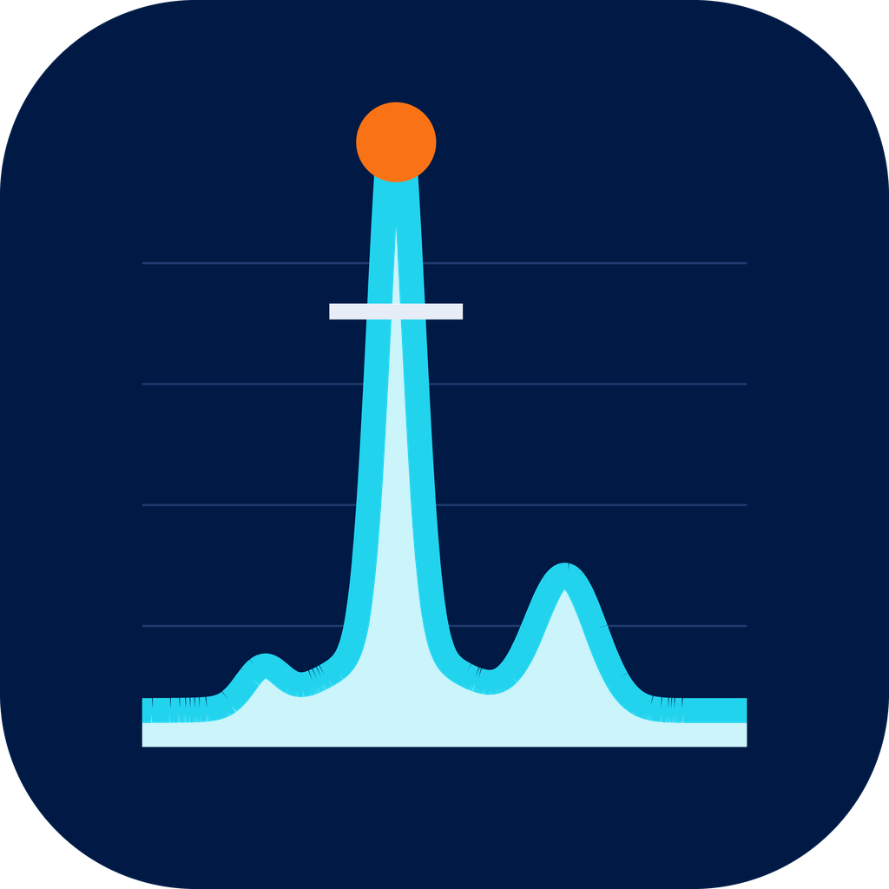
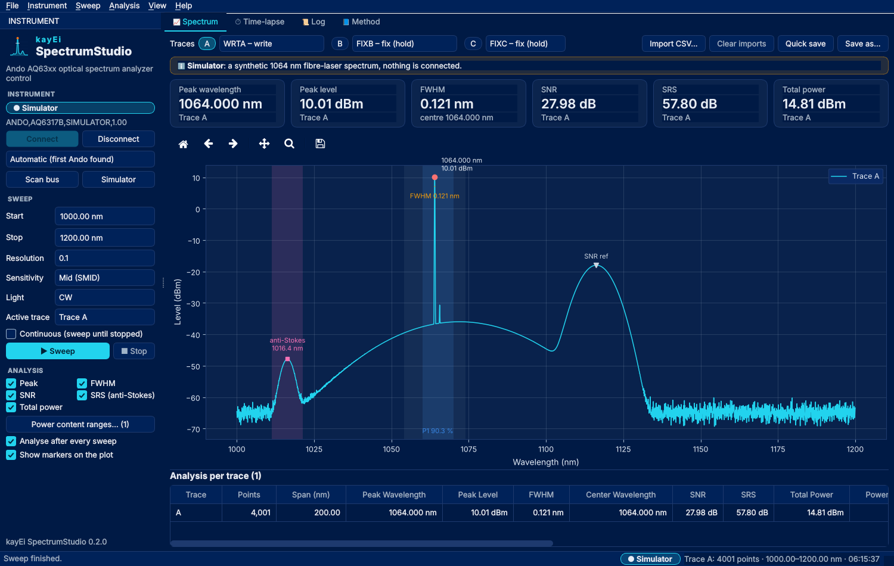

<p align="center"></p>

# kayEi SpectrumStudio

Desktop control for **Ando AQ63xx-series optical spectrum analyzers** (AQ6315, AQ6317 and
similar) over GPIB/VISA: sweeps, trace analysis with markers, automated time-lapses with a
trend, and a simulator so the app can be tried without an instrument. Same look and same
plumbing as kayEi RiskStudio and TwinStudio: a portable Windows build from GitHub Actions,
an in-app update check, a headless command line on the same engine.



* **Sweep**: start / stop wavelength, resolution, sensitivity, CW or pulsed with peak hold,
  the active trace – single or **continuous** (settings changes apply to the next sweep),
  always abortable (the instrument gets `STP`). Every setting is remembered.
* **Traces**: show / hide A, B and C (and on the instrument's screen), set write / fix /
  max-hold / min-hold / rolling-average per trace, overlay imported CSVs.
* **Analysis**: peak, **FWHM** with interpolated −3 dB crossings and the centre wavelength,
  SNR (side-mode style, ±10 nm), SRS anti-Stokes suppression, **total power**, up to five
  **power-content** ranges – as KPI tiles, as markers on the plot, as a sortable / copyable
  table per trace, after every sweep if you like.
* **Time-lapse**: repeated sweeps at a fixed interval; every measurement saved as CSV + PNG
  (+ analysis) into a timestamped folder with a `summary.csv`; live min / max / median
  envelope and the peak wavelength and level over time.
* **Simulator**: a simulated AQ6317B with a 1064 nm fibre-laser spectrum (ASE pedestal,
  Raman Stokes and anti-Stokes, a side mode, a noise floor that follows the sensitivity,
  slow drift). The CI runs the packaged exe against it.
* **Log** of everything that went over the bus, a **command console** for any raw command,
  the **Method** page with the definitions.

## Quick start

### Windows app (recommended)

`kayEi-SpectrumStudio-portable-<version>.zip` is the native desktop application – no Python,
no installer, no admin rights:

* **Get it:** the *Releases* page (or GitHub → *Actions* → *Build Windows app* → latest run →
  artifact `kayEi-SpectrumStudio-portable-…`, with `SHA256SUMS.txt`). Unzip it anywhere (a
  USB stick works) and run `kayei_spectrumstudio.exe`. Nothing is written outside that
  folder except your settings in `~/.kayei_spectrumstudio`, which every version shares.
* **GPIB:** the instrument needs a VISA driver on the PC –
  [NI-VISA](https://www.ni.com/en/support/downloads/drivers/download.ni-visa.html) or Keysight
  IO Libraries – and a GPIB adapter (e.g. NI GPIB-USB-HS). Without one the bundled
  `pyvisa-py` still reaches TCPIP / USB / serial instruments, and the **Simulator** button
  works everywhere.
* **Safe:** built from this repository by GitHub Actions on a clean Windows machine –
  compare the zip's SHA-256 with `SHA256SUMS.txt` from the same run. It talks to no server
  (the optional version check reads the public GitHub release list; switch it off under
  *Instrument ▸ Preferences*).
* **Updates:** *Help ▸ Check for updates* downloads the new zip, verifies it and unpacks it
  into a folder next to the one you run from (`kayEi-SpectrumStudio-<version>`); close the
  old one and start the new one.
* **Unsigned builds** make Windows SmartScreen warn once → *More info → Run anyway*. With a
  code-signing certificate this goes away: store it as repository secrets `WINDOWS_CERT_PFX`
  (base64 of the .pfx) and `WINDOWS_CERT_PASSWORD`; the workflow then signs the app.
* **Release:** bump `__version__` in `ando_osa/__init__.py`, push a tag `v<version>` (or tick
  *release* on a manual run of the workflow). A Linux `.tar.gz` comes from the *Build Linux
  app* workflow (every push to main; on a branch when the commit message carries `[linux]`).

### From source

```bash
pip install -r requirements-desktop.txt
python -m osa_qt.app                  # or run_osa.bat / run_osa.sh
python -m osa_qt.app --simulate       # straight into the simulator
```

Python 3.10+. On Linux use `pyvisa-py` with `linux-gpib`, or NI-VISA.

### Headless (same engine, CI-friendly)

```bash
python -m ando_osa scan                                                    # what is on the bus
python -m ando_osa sweep --start 1000 --stop 1500 --res 0.1 --sens SMID --out trace.csv --png trace.png
python -m ando_osa sweep --simulate --snr --srs --range 1060:1070 --out demo.csv
python -m ando_osa analyze trace.csv --range 1060:1070 --json
python -m ando_osa version
```

`kayei_spectrumstudio.exe` understands the same commands (its output goes to the log file in
the data folder, so use the file outputs).

The driver and the analysis have no GUI dependency and can be used in your own scripts:

```python
from ando_osa.instrument import AndoOSA, open_resource_manager
from ando_osa.analysis import analyze

osa = AndoOSA.find(open_resource_manager())
osa.configure_sweep(1000, 1500, "0.1", "SMID")
osa.start_single_sweep()
while osa.sweep_in_progress():
    ...
wavelengths, levels = osa.read_trace("A")
results, markers = analyze(wavelengths, levels, {"Peak Search": True, "FWHM": True, "SNR": True})
```

## Output files

| File | Content |
|------|---------|
| `timelapse_<date>/measurement_NNN.csv` / `.png` / `_anal.csv` | One time-lapse measurement |
| `timelapse_<date>/summary.csv` | One row per measurement: time, elapsed, every metric |
| `quicksave_<date>/XNNNN.csv` / `.png` / `_overlay.png` / `_anal.csv` | Quick saves of the active trace (plain plot, plot with markers, analysis) |
| `<name>.csv` + `<name>_anal.csv`, or `<name>.png` | *Save as…* |

CSV traces are two columns, `Wavelength (nm),Level (dBm)`; analysis files are `Metric,Value`
rows. PNGs are drawn on white paper for reports (the dark screen look is a preference).

## Analysis definitions (read before trusting the numbers)

* **Peak Search** – wavelength and level of the global maximum.
* **FWHM** – width between the *outermost* −3 dB crossings relative to the peak, interpolated
  between samples; the centre wavelength is their midpoint. With multiple peaks above the
  threshold this spans all of them; it is not a per-peak fit.
* **SNR** – peak level minus the highest level found outside a ±10 nm window around the
  peak. A side-mode-suppression-style figure, not a noise-floor SNR.
* **SRS (Anti-Stokes)** – peak level minus the maximum level within ±5 nm of the expected
  anti-Stokes wavelength for the 13.2 THz Raman shift of fused silica:
  λ<sub>AS</sub> = λ<sub>p</sub> / (1 + Δν·λ<sub>p</sub>/c). *An earlier version searched on
  the Stokes side despite the label; this was corrected.*
* **Total Power** – 10·log<sub>10</sub> of the sum of the linear powers of all samples (a
  sample sum, so compare traces with the same settings only).
* **Power Content** – percentage of the total linear power within each wavelength range.

Constants (windows, Raman shift, −3 dB drop) live at the top of
[`ando_osa/analysis.py`](ando_osa/analysis.py); the Method page in the app says the same.

## Things to verify on your instrument

This software was developed against one instrument; a few command-set details are worth
checking against your unit's programming manual (*Instrument ▸ Send command…* and the Log
page help):

* **Active trace C** is selected with `ACTV2` (per the AQ6317 manual).
* After each sweep the tool issues `REF=P` (reference level to peak) – a preference.
* A sweep is started with `SGL`, stopped with `STP`, and polled with `SWEEP?` (0 = stopped);
  the 40 s timeout is a preference – raise it for slow high-sensitivity sweeps.
* The accepted wavelength range is limited to 350–1750 nm (`ando_osa/instrument.py`).

## Build it yourself

```bash
pip install -r requirements-desktop.txt -r packaging/requirements-build.txt
python packaging/build_exe.py                  # -> dist/kayei_spectrumstudio/ (zip it = the portable build)
python packaging/build_exe.py --bundle         # Linux: + dist/kayEi-SpectrumStudio-<ver>-linux-<arch>.tar.gz
QT_QPA_PLATFORM=offscreen python -m pytest -q  # the tests
python -m osa_qt.app --smoke                   # the self-test the CI runs on the packaged exe
```

## Layout

| Folder | What |
|---|---|
| `ando_osa/` | the engine – VISA driver, simulator, analysis, storage, plots, update check, CLI, method text (no Qt) |
| `osa_qt/` | the desktop app (PySide6): theme, panel, pages, workers, dialogs |
| `assets/` | artwork, drawn by `assets/make_assets.py` |
| `packaging/`, `.github/workflows/` | PyInstaller + CI (Windows portable zip, Linux archive, tests) |
| `docs/` | screenshots (`docs/make_screenshots.py` grabs them from the simulator) |
| `tests/` | analysis, driver (fake bus), simulator, storage, CLI, desktop app (offscreen), platform |

## License

[MIT](LICENSE)
